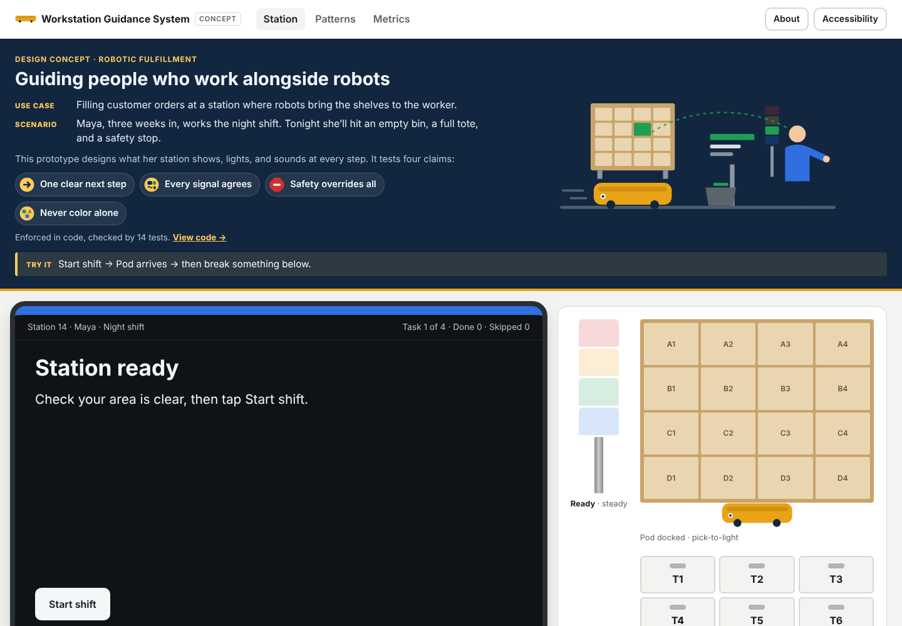
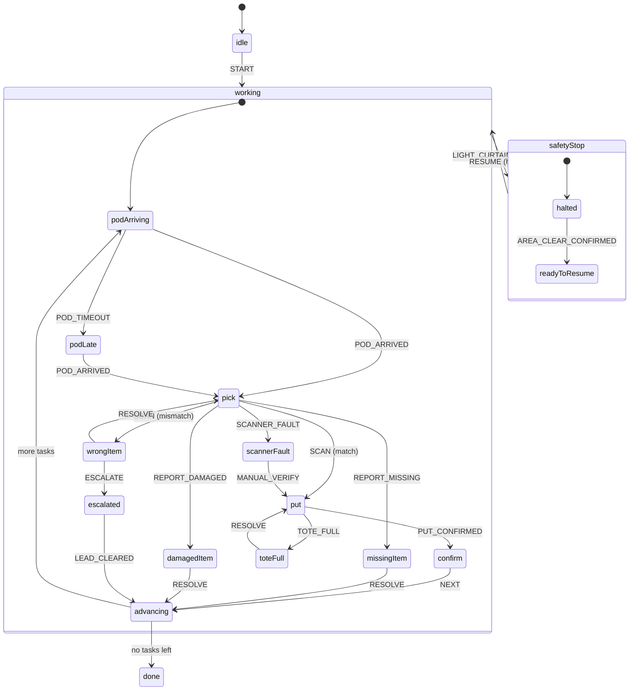

# Workstation Guidance System

**A design concept for guiding a person at a robotic fulfillment workstation through every step, safely, with one clear next step when something goes wrong.**

At a goods-to-person station, a robot brings a storage pod to the worker, who picks items from lit bins into lit totes. The work is fast and repetitive, the floor is loud, and the hard moments are the exceptions: the wrong item, an empty bin, a jammed scanner, a full tote, a safety stop. This project designs and prototypes the guidance for all of it across **screen, lights, sound, and haptics**, driven by one state machine so the channels can never disagree.

> **Concept project.** Fictional station, fictional items, synthetic data. Not affiliated with any company.

**[Try it live →](https://jkelleman.github.io/workstation-guidance-system/)**



## What's inside

| Area | What it shows |
| --- | --- |
| **[Welcome guide and concept banner](src/components/IntroModal.tsx)** | A first-visit guide sets up the use case and scenario (Maya, a newer night-shift picker), shows the work in three illustrated steps, and defines key terms. A banner on every page restates the scenario and the four claims, with an illustrated station scene. |
| **[Station simulator](src/pages/Station.tsx)** | A robot delivers the pod (animated), then a 1280×800 workstation screen, a 4-tier light tower, pick-to-light pod bins, and a put-to-light tote wall. Tone cues via the Web Audio API, haptics via `navigator.vibrate`, optional spoken guidance. |
| **[Exception and recovery flows](src/machine/stationMachine.ts)** | Wrong item, missing item, damaged item, scanner fault, tote full, late pod, escalation to a lead, and a safety stop that overrides everything. |
| **[Accessibility modes](src/App.tsx)** | High contrast, large text, spoken guidance, shapes on lights for color-blind workers, left-hand layout, reduced sound (safety tones stay audible). |
| **[Pattern library](PATTERNS.md)** | 8 reusable patterns, each with a screen / light / sound / haptic mapping table and do/don't guidance. |
| **[Ops metrics](src/pages/Metrics.tsx)** | Synthetic before/after data: units per hour, cycle time, exception rate, time to recover, safety stops, and which design change moves each one. |
| **[Research kit](research/)** | Contextual inquiry and shadowing guide, usability test plan, findings template, illustrative journey map. |
| **[Rollout playbook](playbook/)** | Multi-site launch readiness: pilot criteria, training outline, standard work card, go/no-go metrics, site feedback loop. |

## Design principles

1. **Safe first.** A safety stop overrides every state, and restarting is a deliberate two-step act: confirm the area is clear, then press and hold Resume. Work picks up exactly where it stopped.
2. **One next step.** Every state, including every exception, has a single primary action. The headline says what happened; the body says what to do.
3. **Every signal has a second channel.** Color is always paired with a blink rate, a shape, and a text label. Tones differ in rhythm, not just pitch, so they hold up in noise and for people with partial hearing loss.
4. **Recover without a supervisor when possible.** Self-service recovery comes first; escalation is always available but never the default.
5. **Keep eyes on the work.** The screen hands attention to the lights (bin and tote IDs repeat in both places), and a tote-button press confirms a put with no screen tap.

## How it works



- **[`stationMachine.ts`](src/machine/stationMachine.ts)**: an [XState v5](https://stately.ai/docs/xstate) machine. Safety stop uses a deep history state, so resuming returns to the exact state that was interrupted, including an open exception.
- **[`signals.ts`](src/machine/signals.ts)**: maps each state to one signal set (tower color, blink pattern, shape, label, tone, haptic, headline, instruction, lit bin, lit tote). The UI renders from it; nothing else decides what a channel shows.
- Tested with Vitest: every exception path, the safety-stop override from any working state, two-step resume, resume into an interrupted exception, and the rule that only the safety stop uses red and the octagon.

## Run it

```bash
npm install
npm run dev     # local dev server
npm test        # state machine and signal tests
npm run build   # production build to dist/
```

Requires Node 20+. The layout is responsive and tested on iPhone and Pixel viewports.

## Built with

React, TypeScript, Vite, XState, Recharts, Vitest. Deployed to GitHub Pages by GitHub Actions.

---

## About the designer

**[Jen Kelleman](https://aiwithjen.com)** · [GitHub](https://github.com/jkelleman) · [LinkedIn](https://linkedin.com/in/jenniferkelleman)

Conversation and product designer for AI systems. 12+ yrs designing how products talk to people, from voice UI to agentic AI at Microsoft. Boston.
