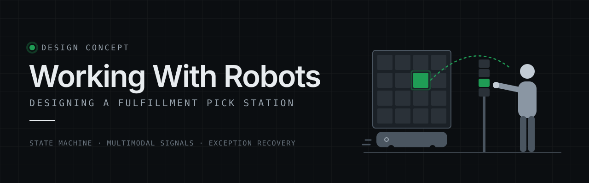

<p align="center">
  
</p>

<p align="center">
  <a href="https://jkelleman.github.io/working-with-robots/"></a>
  <a href="https://github.com/jkelleman/working-with-robots/actions/workflows/ci.yml"></a>
  <a href="https://github.com/jkelleman/working-with-robots/actions/workflows/deploy.yml"></a>
</p>
<p align="center">
  
  
  
  
  
  
  
</p>

# Working With Robots: Designing a Fulfillment Pick Station

**A day in the life of a robotic fulfillment center: robots bring products to a person, who picks each customer order by hand. When something goes wrong, what should her station tell her?**

The work is fast and repetitive, and the floor is loud. The hard moments are when something goes wrong: the wrong item, an empty bin, a scanner that won't read, a full box, a robot running late, a safety stop. This project designs what the station shows, lights up, and sounds in each of those moments, so the person always knows what to do next.

**Here's how that plays out in a fulfillment center:** at a goods-to-person (GTP) pick station, a drive unit brings a pod (a rolling storage tower of fabric bins) to the associate. Pick-to-light marks the bin, and put-to-light marks the order tote on the put wall. The hard moments are a mispick, a short pick, a scanner fault, a full tote, a starved station, and a light curtain trip. The guidance runs across the **screen, stack light, pick-to-light, put-to-light, sound, and haptics**, driven by one state machine so the channels can never disagree.

> **Concept project.** Fictional station, fictional items, synthetic data. Not affiliated with any company.

**[Try it live →](https://jkelleman.github.io/working-with-robots/)**


## What's inside

| Area | What it shows |
| --- | --- |
| **[Welcome guide and concept banner](src/components/IntroModal.tsx)** | A first-visit guide sets up the use case and scenario (Maya, a newer night-shift associate), shows the work in three illustrated steps, and defines key terms. A banner on every page restates the scenario and the four claims, with an illustrated station scene. |
| **[Interactive stage](src/pages/Station.tsx)** | One station scene with a narration panel that explains what's happening and why it's designed that way. A media-style timeline (back, play, next) lets you set the pace. Tap the lit bin to pick and the lit tote to put. |
| **[Station simulator](src/pages/Station.tsx)** | A drive unit delivers the pod (animated), then a 1280×800 station screen, a 4-tier stack light, pick-to-light on the pod bins, and a put-to-light put wall. Tone cues via the Web Audio API, haptics via `navigator.vibrate`, optional spoken guidance. |
| **[What if… cards](src/data/narration.ts)** | Seven ways the pick can go wrong, each one tap away, with a recovery path and a Back to the happy path button. Progress shows how many you've explored. |
| **[Body and reach view](src/components/ErgoView.tsx)** | Side view of the associate at the pod with the power zone (mid-thigh to mid-chest) marked. Each pick shows whether it is in the zone, a reach, or a bend, and top- and bottom-row picks get a posture tip. |
| **[Camera pick verification](src/machine/signals.ts)** | A station setup toggle (handheld scan or overhead camera). With the camera, the associate lifts the item out and the camera confirms it. Instructions, buttons, and mispick wording change to match. |
| **[Safety cover](src/components/Physical.tsx)** | A cover over the pod opening that closes while the pod moves and during an E-stop, and opens when it's time to pick. |
| **[Sources & inspiration](src/pages/Sources.tsx)** | What was borrowed from industry, research, and established practice, why, and where it shows up, plus what's original. |
| **[Exception and recovery flows](src/machine/stationMachine.ts)** | Mispick, short pick, damaged item, scanner fault, tote full, starved station, the andon to Problem Solve, and a light curtain trip (E-stop) that overrides everything. |
| **[Design process and accessibility](src/pages/Process.tsx)** | A first-person case study: why I built it, the five design thinking steps, principles, accessibility considerations, and the outcome. The accessibility modes live here: high contrast, large text, spoken guidance, shapes on lights for color-blind associates, left-hand layout, reduced sound (safety tones stay audible). |
| **[Pattern library](PATTERNS.md)** | 8 reusable patterns, each with a screen / light / sound / haptic mapping table and do/don't guidance. |
| **[Ops metrics](src/pages/Metrics.tsx)** | Synthetic before/after data: units per hour, cycle time, exception rate, time to recover, safety stops, and which design change moves each one. |
| **[Research kit](research/)** | [Proto-persona for Maya](research/persona-maya.md), contextual inquiry and shadowing guide, usability test plan, findings template, illustrative journey map. |
| **[Rollout playbook](playbook/)** | Multi-site launch readiness: pilot criteria, training outline, standard work card, go/no-go metrics, site feedback loop. |

## Key terms

| Term | Meaning |
| --- | --- |
| Goods-to-person (GTP) | Drive units bring inventory to the associate, so no one walks the aisles |
| Pod | Rolling storage tower of fabric bins holding inventory. It never ships. |
| Bin | One fabric compartment in a pod, labeled by row and column (bin B3) |
| Drive unit | The low robot (a type of AMR, autonomous mobile robot) that lifts and carries a pod |
| Pick-to-light / put-to-light | A light marks the bin to pick from and the tote to put to |
| Put wall | Wall of locations, each holding one order tote. Each tote is one customer order. |
| Stack light | Tower of status lights visible across the floor |
| Light curtain trip | The safety beam is broken and nearby drive units E-stop |
| Short pick / mispick | Item missing from the bin / wrong item picked |
| Starved station | Associate is ready, next pod hasn't arrived |
| Andon / Problem Solve | The call for help / the team that answers it |
| WES, fleet manager | Software that assigns pods to stations and dispatches drive units |

## Design principles

1. **Safe first.** A safety stop overrides every state, and restarting is a deliberate two-step act: confirm the area is clear, then press and hold Resume. Work picks up exactly where it stopped.
2. **One next step.** Every state, including every exception, has a single primary action. The headline says what happened. The body says what to do.
3. **Every signal has a second channel.** Color is always paired with a blink rate, a shape, and a text label. Tones differ in rhythm as well as pitch, so they hold up in noise and for people with partial hearing loss.
4. **Recover without Problem Solve when possible.** The associate tries a self-service fix first. The andon is always one tap away.
5. **Keep eyes on the work.** The screen hands attention to the lights (bin and tote IDs repeat in both places), and pressing the put-to-light confirms a put with no screen tap.

## How it works


- **[`stationMachine.ts`](src/machine/stationMachine.ts)**: an [XState v5](https://stately.ai/docs/xstate) machine. Safety stop uses a deep history state, so resuming returns to the exact state that was interrupted, including an open exception.
- **[`signals.ts`](src/machine/signals.ts)**: maps each state to one signal set (stack light color, blink pattern, shape, label, tone, haptic, headline, instruction, pick-to-light bin, put-to-light tote). The UI renders from it, and nothing else decides what a channel shows.
- Tested with Vitest: every exception path, the safety-stop override from any working state, two-step resume, resume into an interrupted exception, and the rule that only the safety stop uses red and the octagon.

## Run it

```bash
npm install
npm run dev     # local dev server
npm test        # state machine and signal tests
npm run build   # production build to dist/
```

Requires Node 20+. The layout is responsive and tested on iPhone and Pixel viewports.

## Built with

React, TypeScript, Vite, XState, Recharts, Vitest. Deployed to GitHub Pages by GitHub Actions.

---

## About the designer

**[Jen Kelleman](https://aiwithjen.com)** · [GitHub](https://github.com/jkelleman) · [LinkedIn](https://linkedin.com/in/jenniferkelleman)

Conversation and product designer for AI systems. 12+ yrs designing how products talk to people, from voice UI to agentic AI at Microsoft. Boston.
